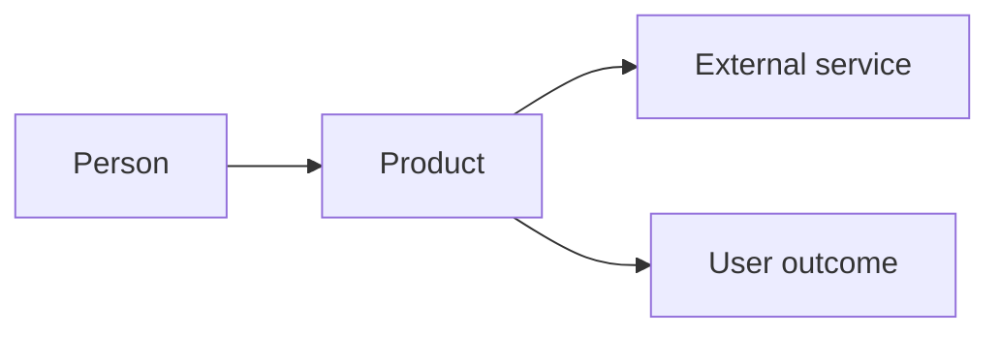
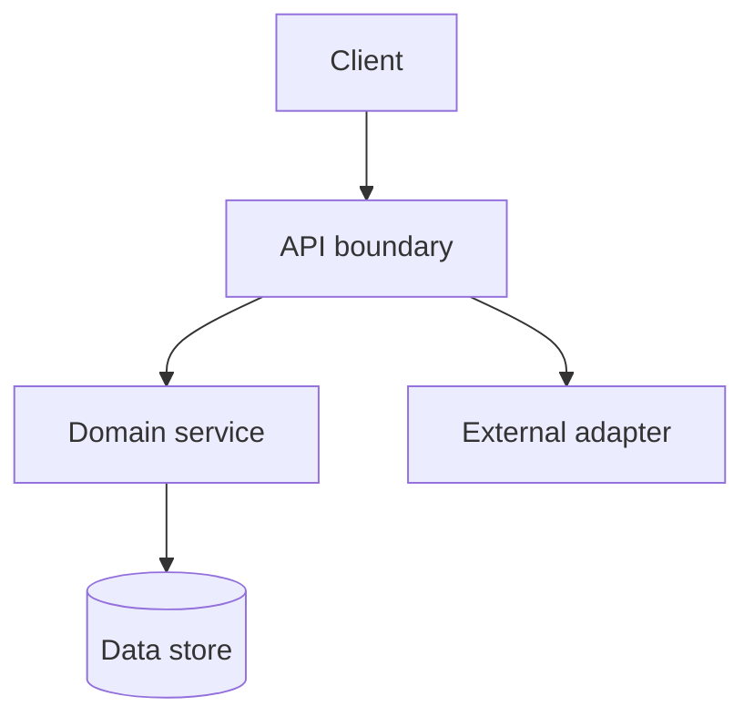
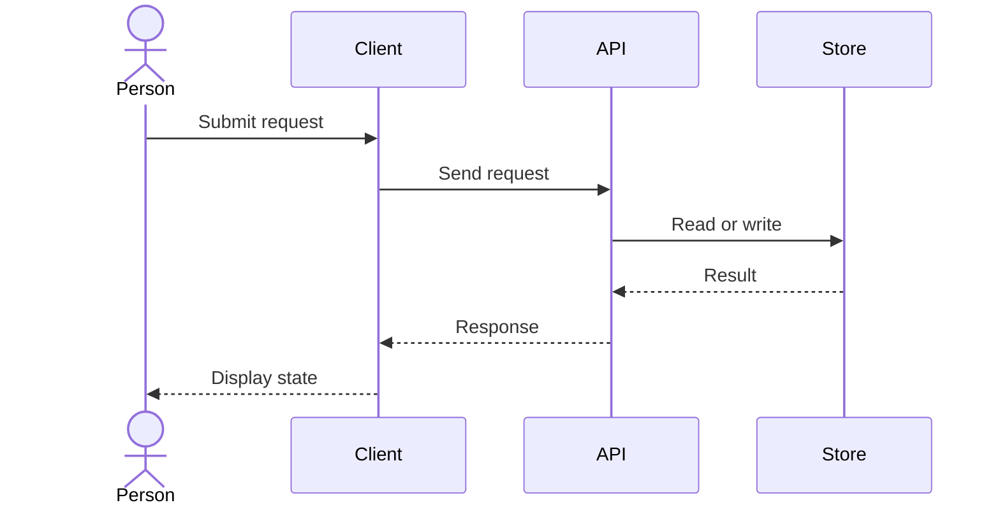
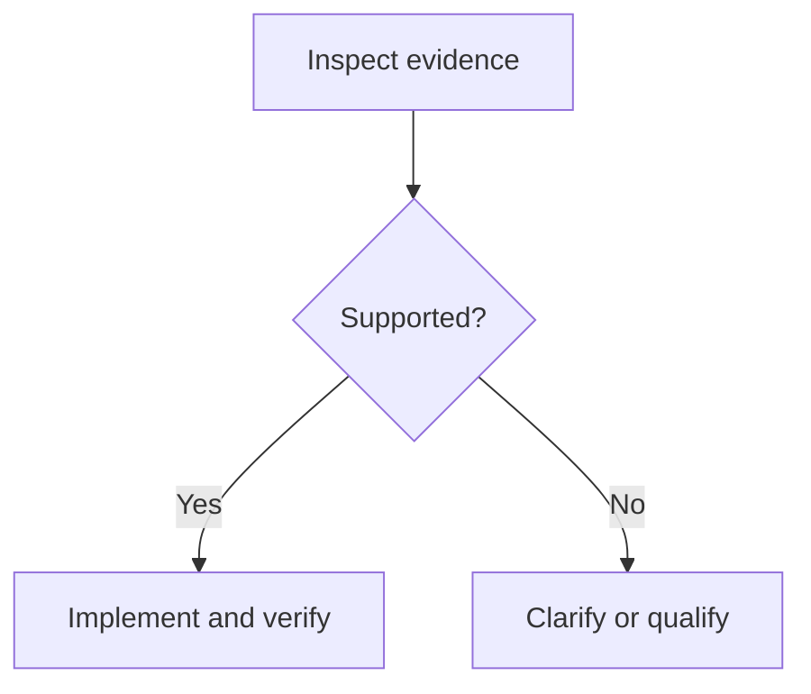

# Diagram craft patterns

These are starting shapes, not mandatory templates. Rename every element and verify relations against the actual source before using them for a real system.

## 1. Executive system landscape

Show only the main system and its external boundaries. An arrow needs a real interaction.

## 2. Technical ownership

Be explicit about process boundaries, state owners and whether edges mean calls, data movement or dependency. C4 container/component views are often better than one giant graph.

## 3. Request sequence

Use for a concrete user journey, including failure paths where they change the outcome.

## 4. Decision or review flow

Use one decision per branch; make conditions explicit. Prefer separate diagrams over deep nested flows.

## Visual acceptance

At final viewing size, a reader should identify the title, primary actors, boundaries and direction in seconds. If text collides, arrows cross ambiguously, or the diagram is only readable when zoomed far in, simplify or split it. Prefer deterministic SVG rendering for exact diagrams; image generation is an illustrative path, not a source-of-truth export.
